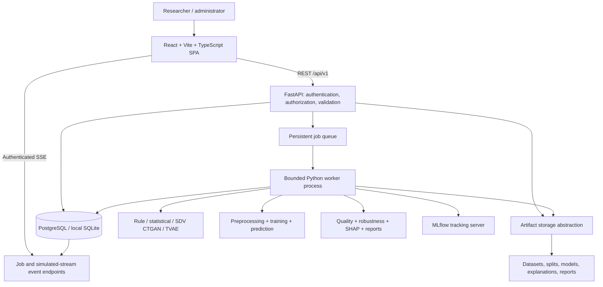

# Retail Fraud Intelligence Platform — Phase 1 design

Status: architecture approved by the user on 4 November 2026. The frontend, authenticated backend, generation, detection, robustness, explanation, monitoring and report workflows are implemented. Local verification uses SQLite and a separate bounded worker. PostgreSQL/Docker runtime verification remains pending. Deployment topology below describes the prepared container configuration rather than a verified hosted service.

## 1. Project understanding and scope

Build a research application for fictional retail transactions: generate data, inject controlled fraud scenarios, train detectors, compare baseline and synthetic augmentation under controlled shifts, explain predictions, and export reproducible results. It is a research simulator, not a payment processor or a production fraud decision system. Ground-truth labels, predictions, and risk thresholds remain separate.

All dashboard values will be derived from persisted jobs and artifacts. An empty installation shows empty states. Optional demo data will require an explicit, labeled seed operation. The system must report negative augmentation results as faithfully as positive ones.

## 2. System architecture

Use a modular monolith initially: React SPA, FastAPI API, relational database, bounded worker process, and filesystem artifact store. Domain engines are Python packages shared by workers and tests. PostgreSQL is the deployment database; SQLite supports one-machine development with a single worker and reduced concurrency.



### Service responsibilities

- Frontend: presentation, persisted useful filters, validation feedback, protected navigation, charts, job subscriptions, and accessible responsive controls.
- API: resource ownership checks, role checks, schemas, bounded requests, search, artifact download authorization, and job submission. CPU-intensive work never executes on the API event loop.
- Worker: atomic job claiming, actual stage updates, cancellation checkpoints, artifact publication, failure logging, and experiment execution. Retries only for retry-safe stages.
- Database: authoritative resource metadata, configurations, state transitions, ownership, metrics, and event history.
- Storage: immutable datasets and split manifests in Parquet; CSV/JSON on export; trusted internally generated model artifacts; versioned reports. Never load user-uploaded pickle files.
- MLflow: parameter/metric/artifact tracking with its run identifier recorded in the application database. The application database remains authoritative if tracking fails; expose tracking failures and permit reconciliation.

### Background processing and real-time behavior

Start with a database-backed queue and a separate bounded worker process, avoiding Redis/Celery until distributed throughput requires them. PostgreSQL workers claim rows transactionally; SQLite supports only one worker. Jobs have queued/running/succeeded/failed/cancelled states, heartbeat, stage, completed units, total units, error code, and timestamps. Stale jobs are marked interrupted and explicitly retried rather than silently declared successful.

SSE sends durable event IDs and supports reconnect. Use fetch-based SSE with authentication headers. Progress is reported from completed chunks/epochs/stages; show indeterminate progress for library calls without reliable counters. A simulated stream is a persisted session producing fictional transactions at a bounded rate; it can run without a model, in which case prediction fields remain absent. Model-backed streams persist predictions and alerts. Stop, expiry, and disconnect behavior are explicit.

### Authentication and deployment boundaries

Registration/login use password hashing with Argon2id. Short-lived JWT access tokens stay in memory; rotating refresh tokens use HttpOnly cookies and hashed server-side session records. Validate issuer, audience, expiry, and token revocation. Protect refresh/logout against CSRF and limit authentication attempts. Roles: researcher and administrator; registration never accepts an administrator role. Resources are private to their owner initially, with explicit project collaboration deferred.

Use a same-origin reverse proxy for frontend, API, and SSE in deployment; HTTPS at ingress. Restrict development CORS origins. Enforce ownership on every resource and download, bounded row counts, safe filenames, structured logs without secrets, and environment-based secrets. Browser UI is not an authorization boundary. MLflow is internal, not publicly exposed. Local development authentication remains enabled.

## 3. Proposed folder structure

```text
Retail-Fraud-Intelligence-Platform/
  frontend/
    src/
      components/{navigation,forms,charts,tables,feedback}/
      layouts/
      pages/
        dashboard/ platform-overview/ synthetic-generator/
        generative-models/ dataset-explorer/ data-quality/ validation/
        fraud-detection/ fraud-simulator/ monitoring/ fraud-patterns/ risk/
        model-training/ model-comparison/ model-registry/ model-prediction/
        robustness/ drift/ imbalance/ noise/ unseen-fraud/ performance/
        shap/ feature-importance/ prediction-explanation/
        experiments/ experiment-history/ reports/ users/ settings/ api-docs/ health/
      services/ hooks/ context/ routes/ types/ utils/
    tests/
    package.json
    vite.config.ts
    Dockerfile
  backend/
    app/
      api/v1/ core/ database/ models/ schemas/ services/ middleware/ workers/
    alembic/versions/
    pyproject.toml
    Dockerfile
  synthetic_data/{generators,statistical,rule_based,ctgan,tvae,validation}/
  fraud_scenarios/{generators,configurations,evaluation}/
  fraud_detection/{preprocessing,feature_engineering,training,prediction}/
  robustness_evaluation/{drift,imbalance,noise,unseen_scenarios,metrics,reports}/
  explainability/{shap,feature_importance}/
  experiments/
  datasets/                 # generated; ignored by Git
  artifacts/                # generated; ignored by Git
  tests/{backend,frontend,integration,e2e}/
  docs/{architecture,api,research}/
  docker/{nginx,mlflow}/
  scripts/
  AGENTS.md
  README.md
  PROJECT_REQUIREMENTS.md
  SYSTEM_ARCHITECTURE.md
  DATABASE_SCHEMA.md
  API_DOCUMENTATION.md
  MODEL_EVALUATION.md
  INSTALLATION_GUIDE.md
  TESTING_GUIDE.md
  DEPLOYMENT_GUIDE.md
  docker-compose.yml
  .env.example
  .gitignore
```

Directories are a proposal, not empty scaffolding to generate now. Dedicated documents will be added as their corresponding phase is implemented, keeping proposed behavior distinct from verified behavior.

## 4. Database schema

Use UUID primary keys, UTC timestamps, foreign-key enforcement, versioned JSON configurations, indexed ownership and query fields. JSON uses SQLAlchemy's portable type with PostgreSQL JSONB where beneficial. Large records remain in artifacts rather than one relational row per generated transaction.

| Table | Principal fields and relationships |
|---|---|
| users | id, unique normalized email, password_hash, role, active, created_at |
| auth_sessions | id, user_id, refresh_token_hash, expires_at, revoked_at, rotation_family |
| user_settings | user_id PK/FK, theme, preferences_json, updated_at |
| artifacts | id, owner_id, relative_storage_key, content_type, bytes, sha256, schema_version |
| generation_configs | id, owner_id, version, method, seed, parameters_json |
| datasets | id, owner_id, parent_dataset_id, generation_config_id, artifact_id, name, row_count, fraud_count, schema_version, checksum, status |
| dataset_metadata | dataset_id PK/FK, column_schema_json, statistics_json, lineage_json, time_bounds_json |
| generative_models | id, owner_id, training_dataset_id, artifact_id, method, config_json, dependency_versions_json, status |
| fraud_scenarios | id, owner_id, name, scenario_type, version, parameters_json |
| scenario_runs | id, scenario_id, source_dataset_id, output_dataset_id, job_id, seed, affected_rows |
| split_manifests | id, dataset_id, artifact_id, split_strategy, config_json, seed, checksum |
| experiments | id, owner_id, name, kind, dataset_id, split_manifest_id, config_json, status, mlflow_run_id |
| training_runs | id, experiment_id, job_id, algorithm, hyperparameters_json, training_data_artifact_id, validation_artifact_id, seed, status |
| ml_models | id, owner_id, training_run_id, artifact_id, preprocessing_artifact_id, threshold, feature_schema_json, version, status |
| model_metrics | id, model_id, experiment_id, evaluation_id, split_name, metric_name, value nullable, undefined_reason |
| evaluation_results | id, experiment_id, model_id, test_artifact_id, predictions_artifact_id, confusion_json, curves_artifact_id, calibration_json |
| robustness_evaluations | id, experiment_id, baseline_model_id, augmented_model_id, perturbation_config_json, results_artifact_id, status |
| predictions | id, owner_id, model_id, dataset_id nullable, stream_session_id nullable, transaction_id, features_json, probability nullable, anomaly_score nullable, predicted_class, threshold, created_at |
| explanations | id, prediction_id nullable, model_id, background_artifact_id, artifact_id, method, output_space, config_json |
| quality_reports | id, dataset_id, reference_dataset_id nullable, artifact_id, metrics_json, status |
| reports | id, owner_id, experiment_id nullable, dataset_id nullable, kind, format, artifact_id, created_at |
| jobs | id, owner_id, kind, resource_id, config_json, state, stage, completed_units, total_units nullable, heartbeat_at, error_json, started_at, finished_at |
| job_events | id monotonic, job_id, state, stage, payload_json, created_at |
| experiment_events | id, experiment_id, event_type, payload_json, created_at |
| stream_sessions | id, owner_id, model_id nullable, config_json, state, generated_count, started_at, expires_at |
| notifications | id, user_id, prediction_id nullable, job_id nullable, severity, message, read_at, created_at |
| audit_events | id, actor_id nullable, action, resource_type, resource_id, metadata_json, created_at |

Primary relationships: user owns datasets/models/experiments/jobs; dataset references immutable artifacts and its lineage; experiment references a fixed split manifest; training runs create versioned models; evaluation results reference exact model/test artifacts; predictions reference model versions; reports reference their source experiment or dataset.

Indexes: `(owner_id, created_at)` on owned resources, `(state, created_at)` on jobs, `(job_id, id)` on events, `(model_id, created_at)` and `(transaction_id)` on predictions, `(experiment_id, metric_name)` on metrics, `(user_id, read_at)` on notifications. Add unique model version and metric context constraints. Deletions are restricted for referenced research artifacts; explicit retention cleanup must preserve lineage or reject deletion. Alembic handles schema creation and upgrades; do not rely on runtime create_all for deployment.

## 5. Frontend pages and UI structure

Fixed sidebar: 270px expanded, 76px collapsed; mobile drawer. Topbar: breadcrumbs, global search, notifications, theme, profile, settings, connection status. All routes are separate React page components using shared primitives, with page-specific workflows. Data and job state are shared through typed services/hooks; URL search parameters persist selected datasets and filters. Loading, error, empty, and permission states are explicit.

| # | Group / page | Route | Actual functionality |
|---|---|---|---|
| 1 | Overview / Dashboard | /dashboard | Persisted totals, activity/fraud trends, model/quality/robustness charts, recent datasets, experiments, alerts and jobs; empty charts when no results exist |
| 2 | Platform Overview | /overview | Workflow map, available engine capabilities, readiness and links to the next executable step |
| 3 | Synthetic Data Generator | /synthetic/generate | Configure count, rate, amount distribution, categories, payments, devices, dates, regions, seed and method; submit job, preview/export output |
| 4 | Generative AI Models | /synthetic/models | Configure/train CTGAN/TVAE on a selected seed dataset; inspect epochs/status/metadata and conditionally sample |
| 5 | Dataset Explorer | /datasets | Paginated datasets and row previews, schema, search, filters, metadata, lineage and exports |
| 6 | Data Quality Analysis | /synthetic/quality | Compare selected/reference datasets: distributions, correlations, category coverage and quality reports |
| 7 | Synthetic Data Validation | /synthetic/validation | Run schema, bounds, missingness, uniqueness and cross-field constraints; inspect invalid rows |
| 8 | Fraud Detection | /fraud/detect | Score a dataset with a registered model; predicted risk versus separate available ground truth; export predictions |
| 9 | Fraud Scenario Simulator | /fraud/scenarios | Configure ten scenario families, affected fraction and severity; generate derived dataset and inspect execution history |
| 10 | Transaction Monitoring | /fraud/monitoring | Start/stop labeled synthetic stream, select model, inspect live rows/alerts, filter amount/date/label/risk |
| 11 | Fraud Pattern Analysis | /fraud/patterns | Aggregate observed labels or predictions by scenario/category/device/time; explicitly select analysis source |
| 12 | Risk Analysis | /fraud/risk | Probability distributions, threshold sensitivity, risk bands and expected false-positive/false-negative counts where labels exist |
| 13 | Model Training | /models/train | Dataset/split/algorithm selection, bounded tuning, class weights, job progress and validation metrics |
| 14 | Model Comparison | /models/compare | Compare compatible held-out evaluations using PR/ROC curves, recall, precision, calibration and confusion matrices |
| 15 | Model Registry | /models/registry | Versioned artifacts, feature contracts, lineage, readiness, activation and retirement with ownership checks |
| 16 | Model Prediction | /models/predict | Validate a single fictional transaction or selected dataset, return prediction and save history |
| 17 | Robustness Testing | /robustness | Execute paired A–F experiments, compare baseline/augmentation and inspect scorecard |
| 18 | Data Drift Analysis | /robustness/drift | Numerical/categorical distribution shifts, temporal windows, effect sizes and dataset comparison |
| 19 | Class Imbalance Analysis | /robustness/imbalance | Controlled prevalence sweep, class counts and precision/recall/PR-AUC versus prevalence |
| 20 | Noise Sensitivity Testing | /robustness/noise | Numeric/categorical noise and missingness sweeps with degradation curves |
| 21 | Unseen Fraud Evaluation | /robustness/unseen | Reserve a fraud family from all training/augmentation, evaluate paired models on locked novel-pattern cases |
| 22 | Performance Evaluation | /robustness/performance | Held-out metrics, confidence intervals, recall at target FPR, calibration and paired differences |
| 23 | SHAP Analysis | /explainability/shap | Bounded SHAP background/sample configuration, summary/beeswarm and global attribution distributions |
| 24 | Feature Importance | /explainability/features | Global SHAP aggregation and held-out permutation importance; distinguish methods and transformed/original features |
| 25 | Individual Prediction Explanation | /explainability/prediction | Select persisted prediction, see SHAP waterfall, feature values, output scale and model limitations |
| 26 | Experiments | /experiments | Configure named research runs, fixed splits, seeds, augmentation ratios and test conditions |
| 27 | Experiment History | /experiments/history | Filter previous runs, inspect parameters/lineage/events, compare and reproducibly rerun configurations |
| 28 | Evaluation Reports | /reports | Generate/download real dataset, quality, comparison, robustness and experiment PDF/CSV reports |
| 29 | User Management | /admin/users | Administrator-only user listing, role/active-state changes; prevent removal of the last active administrator |
| 30 | Settings | /settings | Profile, theme, preferences, notification settings and documented resource limits |
| 31 | API Documentation | /system/api | OpenAPI reference, authenticated request examples, schema descriptions and link to Swagger |
| 32 | System Health | /system/health | Dependency health, worker heartbeat, queue depth, storage readiness, MLflow availability and engine capabilities |

Global search searches authorized pages, datasets, experiments and persisted transaction identifiers. Recharts handles common charts; load Plotly only for figures needing richer interaction. Tailwind tokens define typography, spacing, focus, chart palette and light/dark themes. Keyboard navigation and WCAG AA contrast are design targets. Avoid using color alone for labels or risk.

## 6. Backend API specification

Prefix `/api/v1`. UUID resource identifiers. List endpoints accept bounded `limit` and cursor; row previews add validated filter/sort parameters. Timestamps are ISO-8601 UTC. Async operations return HTTP 202 `{job_id, resource_id, status_url, events_url}`; submission is not completion. Errors use `{error: {code, message, details, request_id}}`. Support idempotency keys on expensive job submissions.

| Domain | Endpoints |
|---|---|
| Authentication | POST /auth/register, /auth/login, /auth/refresh, /auth/logout; GET /auth/me |
| Users/settings | GET /users; PATCH /users/{id} (admin); GET/PATCH /settings; PATCH /profile |
| Dataset generation | POST /datasets/generate; GET /datasets; GET /datasets/{id}; GET /datasets/{id}/preview; GET /datasets/{id}/statistics |
| Dataset export/validation | GET /datasets/{id}/download?format=csv\|json; POST /datasets/{id}/validate; GET /datasets/{id}/validation |
| Quality | POST /quality/evaluations with dataset/reference IDs; GET /quality/evaluations/{id} |
| Generative models | GET /generative-models; POST /generative-models/train; GET /generative-models/{id}; POST /generative-models/{id}/generate |
| Scenarios | GET /scenarios/catalog; GET/POST /scenarios; PATCH /scenarios/{id}; POST /scenarios/{id}/runs; GET /scenario-runs; GET /scenario-runs/{id} |
| Training/registry | POST /models/train; GET /models; GET /models/{id}; PATCH /models/{id}/status; POST /models/comparison |
| Predictions | POST /predictions; POST /predictions/batch; GET /predictions; GET /predictions/{id} |
| Robustness | POST /robustness/runs; GET /robustness/runs/{id}; POST /robustness/drift, /robustness/imbalance, /robustness/noise, /robustness/unseen; POST /robustness/comparison |
| Evaluation | GET /evaluations/{id}; GET /evaluations/{id}/curves; POST /evaluations/threshold-analysis |
| Explanations | POST /explanations/global; POST /predictions/{id}/explanation; GET /explanations/{id}; POST /feature-importance |
| Experiments | POST/GET /experiments; GET /experiments/{id}; GET /experiments/{id}/history; POST /experiments/{id}/rerun |
| Reports | POST /reports; GET /reports; GET /reports/{id}; GET /reports/{id}/download |
| Background jobs | GET /jobs; GET /jobs/{id}; GET /jobs/{id}/events (SSE); POST /jobs/{id}/cancel |
| Simulated streams | POST /streams; GET /streams/{id}; GET /streams/{id}/events (SSE); POST /streams/{id}/stop |
| Dashboard/analytics | GET /dashboard; GET /analytics/activity, /analytics/patterns, /analytics/risk |
| Search/notifications | GET /search?q=; GET /notifications; PATCH /notifications/{id} |
| System | GET /health/live; GET /health/ready; GET /system/status; GET /capabilities; GET /openapi.json; GET /docs |

Example generation request:

```json
{
  "name": "baseline-seed-42",
  "method": "statistical",
  "rows": 10000,
  "fraud_rate": 0.02,
  "seed": 42,
  "amount_distribution": {"family": "lognormal", "median": 65, "sigma": 0.9},
  "categories": ["grocery", "electronics", "clothing"],
  "payment_methods": ["card", "wallet"],
  "device_types": ["mobile", "desktop"],
  "regions": ["region_a", "region_b"],
  "start_at": "2026-01-01T00:00:00Z",
  "end_at": "2026-01-31T23:59:59Z"
}
```

The final Pydantic/OpenAPI schemas will constrain enums, dates, rate in [0,1], row/resource limits, and compatible model/method options. Dataset-level APIs must not permit label leakage into inference feature vectors. Reports and downloads use authenticated streaming responses.

## 7. Synthetic data generation methodology

### Canonical schema

Include all requested fields: transaction_id, customer_id, product_id, product_category, transaction_amount, quantity, transaction_timestamp, payment_method, device_type, location_region, customer_account_age_days, transaction_frequency, previous_transaction_amount, shipping_address_change, billing_shipping_mismatch, transaction_velocity and is_fraud. Add scenario_type and scenario_version as ground-truth metadata excluded from model features. IDs are fictional and excluded from predictors by default. Amounts use a declared single research currency and two-decimal precision; multi-currency behavior is deferred.

### Generation pipeline

1. Validate a versioned configuration, determine deterministic random streams, and record software versions.
2. Construct fictional customers/products and timestamped purchase sequences with customer/category/time-conditioned amounts, devices and behavior. Temporal features use only earlier transactions.
3. Rule generator applies declared distributions and relationships; statistical generator samples fitted empirical/marginal distributions and dependence structure. Neither is presented as a learned GAN.
4. CTGAN/TVAE use SDV metadata and constraints, fit on an explicitly selected artificial seed training partition, and serialize internal trusted artifacts. Rebuild unique identifiers and revalidate sampled rows. Conditional generation uses supported SDV conditional APIs with bounded rejection/resampling where needed; impossible conditions return an explicit error.
5. Inject configured fraud behaviors at selected rates and severity, without making a single feature a perfect label proxy. Labels describe simulator ground truth, not verified real-world fraud.
6. Validate types, finite nonnegative amounts, positive quantities, timestamp bounds, category membership, binary fields, unique transaction IDs, missingness and chronological feature consistency. Publish only completed artifacts with checksum and lineage.

All sampling, scenario injection, and split seeds are recorded separately. Statistical/rule paths target deterministic repeatability; deep-learning paths document hardware/library nondeterminism rather than promise bitwise identity.

Quality evaluation includes SDV quality reports where applicable, invalid-record counts, duplicates (both identifier and business-feature duplicates), categorical total-variation/Jensen–Shannon distances, numerical KS/Wasserstein statistics, correlation differences, diversity and coverage. Report metrics separately with definitions, reference set, sample sizes and limitations. Never equate quality scores with privacy guarantees. Optional privacy analysis is outside the initial acceptance scope.

## 8. Fraud scenarios and detection methodology

Scenario families: high amount, rapid purchases, short-window bursts, device change, address mismatch, unusual hour, frequency anomaly, purchasing-pattern anomaly, population distribution shift and novel feature combinations. Sequence-based scenarios modify coherent customer histories before recomputing past-only derived features. A shift need not imply fraud: scenario metadata states whether it changes behavior, labels, or both. Version scenario definitions and avoid exposing injection markers to models.

Preprocessing uses a fitted scikit-learn Pipeline/ColumnTransformer: numeric imputation and optional scaling, categorical imputation and unknown-safe encoding. Deduplicate and validate before splitting with rules that do not learn from the test set. Exclude label, scenario metadata, identifiers and future-derived statistics. Feature generation uses historical information available at prediction time, including across split boundaries only when legitimately observable.

Chronological train/validation/test splits are default; grouped customer splits offer a separate cold-start study. Use validation for tuning, threshold selection, and calibration. Freeze test sets before training generators. Train augmentation generators only on training partitions; never feed validation/test data to generators or encoders. Fit preprocessing exclusively on each corresponding training set. Respect time order in tuning folds.

Models: Logistic Regression, Random Forest, XGBoost; Isolation Forest is an optional anomaly baseline, with score direction and threshold calibrated using validation data. Do not label Isolation Forest anomaly scores as probabilities without a separately validated calibration layer. Store entire preprocessing/model contracts and reject incompatible inputs.

Evaluate accuracy as secondary context; prioritize precision, recall, F1 and PR-AUC (average precision, explicitly named), ROC-AUC, confusion matrix, FPR/FNR, Brier score and reliability curves/ECE with stated bins. Undefined metrics are null with reasons, not fabricated zeroes. Thresholds are validation-selected and fixed before final testing. Hyperparameter search has explicit time/trial budgets.

SHAP uses a training-only sampled background, bounded explanation samples, and supported explainers for each algorithm. Explain transformed and original features with a documented aggregation mapping; disclose probability versus log-odds output. Use a bounded model-agnostic fallback when an optimized explainer is unsupported. Show additive consistency diagnostics and state that attributions explain model behavior, not proof of actual fraud.

## 9. Robustness research protocol

The central question is whether training augmentation improves performance on shared held-out tests, not whether synthetic classifiers achieve high accuracy on generator artifacts.

1. Generate/version a baseline population, reserve time-ordered train/validation/test partitions, and persist split manifests and hashes.
2. Define shifted and unseen test populations independently. Reserve unseen fraud families from baseline training AND augmentation; name an additional exposure-to-new-patterns study separately if desired.
3. Fit augmentation generators exclusively on baseline training data. Compare baseline versus baseline+augmentation at declared ratios, with equal tuning budgets and training-cost reporting. Add a same-size rule/statistical augmentation control to distinguish volume effects from generative-model effects.
4. Train paired models with predeclared thresholds chosen on validation data. Freeze models before final evaluations.
5. Run paired A–F comparisons on exactly shared test rows:

| Experiment | Training | Test |
|---|---|---|
| A | Baseline | Held-out baseline |
| B | Augmented | Same held-out baseline |
| C | Baseline | Shifted |
| D | Augmented | Same shifted |
| E | Baseline | Unseen fraud |
| F | Augmented | Same unseen fraud |

6. Sweep prevalence, amount distribution, time, missingness, numerical/categorical noise, behavior, frequency and category shifts. Separate label-preserving measurement corruption from population/scenario changes; recompute sequence features consistently where behavior changes.
7. Repeat across recorded independent seeds. Report paired differences, confidence intervals from customer/block bootstrap where observations are dependent, counts of positives/negatives and training/generation costs. Small studies display uncertainty and insufficient-sample warnings.

Drift metrics include per-feature KS/Wasserstein and categorical Jensen–Shannon/total-variation with effect sizes. Distinguish observed distribution change from measured predictive harm. Prevalence sweeps must state test composition because PR-AUC and precision depend on prevalence.

Recall at target FPR: choose validation thresholds at target FPRs, then report achieved test FPR and recall; interpolated ROC recall may also be shown as a separately labeled diagnostic. No test-driven threshold tuning.

Performance degradation is baseline-test metric minus stressed-test metric for the same frozen model. Show absolute percentage-point change and relative change only when the denominator is nonzero. Primary scorecard displays individual conditions. Optional retention score: `100 × mean(min(1, stressed_recall / baseline_recall))` at a fixed validation-selected threshold over predeclared stress conditions, undefined when baseline recall is zero. This capped recall summary is supplementary, always accompanied by precision/FPR, and does not establish safety or improvement. Paired augmentation delta remains signed, including negative results.

Reports include full configuration, dataset/model/split hashes, thresholds, software versions, seeds, actual metrics/curves, uncertainty, failed runs and limitations. Artificial training/reference populations cannot establish real-world detection efficacy or privacy.

## 10. Development phases, dependencies and gates

| Phase | Deliverables | Verification / prerequisite |
|---|---|---|
| 1 Architecture | This reviewable design and open decisions | User approval required before implementation |
| 2 Frontend shell | Design tokens, responsive layout, 32 routes/components, auth layout, chart/table/feedback primitives, light/dark themes | Route coverage, keyboard/mobile navigation and direct URLs; explicitly label unavailable backend actions |
| 3 Backend foundation | Database migrations, auth/RBAC, API schemas, artifacts, persistent workers/SSE, health/logging | Migration round trip, authorization/isolation, worker recovery and API smoke tests |
| 4 Generation | Rule/statistical engines, SDV CTGAN/TVAE, validation, quality and exports | Seed reproducibility, schema constraints, conditional sampling, tiny actual SDV training smoke tests |
| 5 Scenarios | Ten coherent scenario families, metadata/history | Parameter bounds, actual mutations, retained ground truth and temporal consistency |
| 6 ML | Pipelines, four algorithms, bounded tuning, registry/inference/tracking | Leakage tests, serialization parity, unknown categories, undefined-metric handling |
| 7 Robustness | Locked test manifests, A–F runner, stress sweeps, uncertainty/scorecard | Shared-test assertions, unseen-family exclusion, signed differences, reproducible configs |
| 8 Explainability | Global/local SHAP, feature mapping and importance | Actual attribution generation and additive checks within documented tolerance |
| 9 Full integration | Every page connected to actual APIs; authorized search/downloads | Workflow/component/integration coverage; no fabricated dashboard results |
| 10 Real-time completion | Monitoring, persisted predictions/alerts, reconnect/cancellation | Start/stop/reconnect, worker failures, actual progress and dashboard updates |
| 11 QA | Pytest, Vitest/RTL and Playwright suites | Register → generate → train → predict → A–F → explain → export; admin/ownership negative tests |
| 12 Deployment/docs | Docker Compose, migration startup, health checks, environment and guides | Clean startup on PostgreSQL, persistent volume restart, frontend deep links, documented resource profile |

Implement API integration per module as it becomes available; Phase 9 completes cross-module integration rather than postponing all validation. Job/SSE infrastructure belongs in Phase 3; Phase 10 completes end-user stream behavior. Each milestone stays runnable with honest empty/unavailable states. No phase is called complete without its verification evidence.

Dependency graph: shell → foundation → generation → scenarios → ML → robustness → SHAP → integrated workflows → real-time verification → full QA → deployment acceptance. Documentation and security checks progress alongside each phase.

## 11. Dependencies and deployment plan

The additional hosted profile uses Vercel for the unchanged React SPA and a same-origin external `/api` rewrite to Railway. One Railway container supervises the FastAPI process and a separate bounded worker, using PostgreSQL plus a single persistent volume for artifacts and internal MLflow tracking. This preserves the worker/API separation while allowing both processes to access the same filesystem. `app.hosted` migrates before serving, drops root privileges after preparing the volume directory, and stops the service if either child exits. Hosted readiness requires database schema, worker heartbeat and writable storage. The profile is single-replica; scaling requires shared object storage or a different storage topology. Cloud deployment and live PostgreSQL verification are recorded separately in docs/ACCEPTANCE.md.

Frontend: React, Vite, TypeScript, Tailwind, React Router, Axios, Recharts, Lucide; optional lazy Plotly. Backend: FastAPI, Uvicorn, Pydantic, SQLAlchemy, Alembic, PostgreSQL driver, Argon2/JWT libraries. Research: NumPy, Pandas, SciPy, scikit-learn, SDV (CTGAN/TVAE), XGBoost, SHAP and MLflow. Tests: Pytest, Vitest, React Testing Library and Playwright.

Version compatibility will be verified against current official documentation and package metadata during implementation, especially Python/PyTorch/SDV/SHAP/NumPy support. Commit exact tested lockfiles; do not invent a compatible version matrix at design time. Separate core and heavy research dependency groups, while the full deployment profile includes all required engines. Capability endpoints clearly report absent optional packages.

Docker Compose: frontend reverse proxy, API, worker, PostgreSQL and MLflow with persistent volumes. MLflow uses separate tracking schema/database and artifact storage. A migration service runs before API/worker readiness. Redis is unnecessary in the initial queue design. Local URLs proposed: frontend `http://localhost:5173` in Vite development, backend `http://localhost:8000`, Swagger `http://localhost:8000/docs`; Compose frontend `http://localhost:8080`. Tracking port is bound to localhost only when explicitly enabled for development.

## 12. Hardware and resource estimates

These are planning estimates, not benchmark results; measure and revise during implementation.

| Profile | Planning resources | Intended workload |
|---|---|---|
| Core local development | 4 CPU cores, 8 GB RAM, 10–15 GB free disk | UI/API/SQLite, rule/statistical generation and small sklearn runs; one worker |
| Full local demonstration | 8 CPU cores, 16 GB RAM, 25–40 GB free disk | PostgreSQL/MLflow/Docker, 10k–100k-row studies, small CTGAN/TVAE runs |
| Larger research runs | 8–16+ CPU cores, 32+ GB RAM, 50+ GB disk; optional supported GPU | Repeated experiments, higher cardinality and larger learned generators |

GPU is optional; CPU generative training can be slow. Initial configurable defaults: 10k rows per interactive generation, maximum 100k before explicit resource-limit adjustment, one heavy job concurrently, bounded tuning and sampled SHAP. Limit epochs, categories, SSE rate, export size and runtime; report resource-limit failures accurately. GPU/driver support and actual host capacity require discovery in the implementation phase. Windows users can run native development or Docker Desktop with WSL2, subject to machine availability.

## 13. Missing requirements, assumptions and risks

| Topic | Proposed default / risk handling |
|---|---|
| Approval gate | Architecture approved; user subsequently authorized all remaining phases |
| Intended users/tenancy | One local organization, private researcher-owned resources; sharing not in first scope |
| Real data ingestion | Artificial seed data only initially; external CSV upload is not assumed authorized or required |
| Dataset size/runtime | Conservative defaults above; benchmark before expanding |
| Currency/timezones | One declared research currency, UTC storage, user-local display; no exchange-rate logic |
| Research claim | Synthetic-only findings cannot establish real-world fraud efficacy |
| Label construction | Simulation rules can create trivial shortcuts; vary severity/overlap and audit leakage |
| Temporal consistency | Independent row generators can break customer histories; validate or reconstruct sequence features and disclose resulting constraints |
| Novel fraud definition | Reserve scenario families from all training/augmentation; independent combination studies must state novelty precisely |
| Extremely low prevalence | Some splits lack positives; require sufficient class counts or return undefined metrics with reasons |
| Deep-learning dependencies | Heavy packages, platform support and GPU nondeterminism; verify actual supported versions and smoke-test both engines |
| Deployment reliability | Local queue has limited throughput; distributed workers/Celery can be a later migration with unchanged job contract |
| Storage growth | Dataset/prediction retention configurable; no automatic destructive cleanup without a documented policy |
| Authentication lifecycle | Local admin bootstrap; email verification, password recovery/SMTP, SSO and MFA require separate provider/product decisions before public deployment |
| Operational scope | Local/demo deployment is the initial target; public hosting needs domain/TLS, backups, observability, recovery targets and a threat-model review |
| Model validity | No automatic promotion by accuracy; compare fraud-focused validation criteria, document thresholds and uncertainty |
| Test cost | Small genuine GAN/VAE smoke tests in a heavy integration suite; full studies run separately, with skips clearly reported |

The preceding design records the approved defaults. Implementation now includes the full local workflow; see docs/ACCEPTANCE.md for delivered functionality and verification boundaries.

